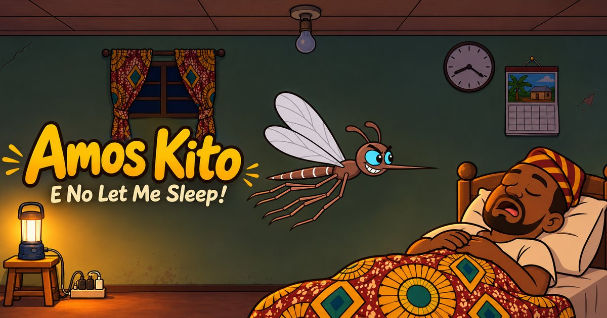

# Amos Kito: E No Let Me Sleep!

A one-tap browser game set in a Nigerian bedroom at night. You are **Amos Kito**, a cheeky mosquito trying to reach the man asleep under his wrapper, while hanging clothes, bedposts and mosquito coils drift across the room. Touch anything and *dem don slap you*.

**Play it:** https://amos-kito.banjezamai.workers.dev/



## How to play

- **Tap, click or press Space** to flap. Gravity pulls Amos down between flaps.
- Fly through the gap in each pair of obstacles to earn a **Bite**.
- Hit the clothes, a bedpost, the coil or its smoke, or the floor, and you're slapped.
- **NEPA brings light.** Every so often the power comes back. The bulb flickers, someone shouts "Up NEPA!", the room lights up, the sleeper half-wakes and the fan blows gusts that push Amos up and down. Survive until the power cuts again ("NEPA Took Light!") for **+3 Bites**.
- The game speeds up and the gaps narrow as your score climbs.
- After a slap, tap **Fly again** to restart, or **Share score** to send your score to friends.

### Keys

| Key | Does |
| --- | --- |
| Space | Flap |
| M | Mute or unmute (remembered) |
| D | Debug: show hitboxes |
| N | Debug: start the NEPA power event now |

## Run it locally

It's plain JavaScript, HTML and a canvas, with no framework and no build step. The code uses ES modules, which browsers won't load from a `file://` path, so serve the folder with any static web server and open the address it prints:

```powershell
npx serve .
```

or, with Python installed:

```powershell
python -m http.server 8000
```

Then open http://localhost:8000 (or the port `serve` shows). Use your browser's phone emulation to test the portrait layout.

## Project structure

```
index.html        page, title and link-preview tags
style.css         full-screen layout, blocks scrolling and zoom
src/
  main.js         boot, fixed-timestep loop (60 updates/s), scaling, input
  game.js         states (title, ready, playing, paused, dying, game over), drawing, share
  mosquito.js     Amos: flap, gravity, ceiling stop, drawing
  obstacles.js    obstacle pairs, scrolling, scoring, difficulty ramp
  nepa.js         power event, lighting, fan gusts, wind lines, banners
  sprites.js      asset table, loader, hitboxes, outlines, obstacle cropping
  audio.js        Web Audio: synthesised effects, recorded voice lines, mute
  config.js       every tunable number in one place
assets/
  sprites/        Amos's wing-flap strip and dazed still
  images/         room, sleeper, fan, obstacles, logo, link preview
  audio/          recorded voice lines
```

## Tuning

Every number that changes how the game feels lives in [`src/config.js`](src/config.js): gravity, flap push, scroll speed, gap size, the difficulty ramp, NEPA timings, gust strength, death sequence timings, lighting, volumes and the game-over lines. Change a value, reload, and play.

Each sprite's on-screen size and hitboxes are in the asset table at the top of [`src/sprites.js`](src/sprites.js). Hitboxes are in on-screen pixels and cover only the solid parts, so near-misses count as misses. Press **D** in game to see them.

If an image fails to load, the game draws coloured boxes in its place, so it stays playable.

## Sound

The buzz, snoring, distant generator, fan, light switch, bulb flicker, power cut and slap are all synthesised in code with the Web Audio API, so there are no sound licences to track. Sound starts on the first tap, as browsers require.

The voice lines are recordings in `assets/audio/`, listed in `AUDIO_FILES` in `config.js`. To add or replace a sound, put the file in `assets/audio/` and set its path there. Setting a path for an effect (`switch`, `bulbBuzz`, `powerCut`, `slap`) replaces the synthesised version.

The game shows every voice line as text too, so it stays clear with the sound off.

## Deploying

The game is hosted on Cloudflare, connected to this repository. Every push to `main` goes live automatically within a minute or two. [`.assetsignore`](.assetsignore) keeps repo files such as this README off the public site.

Any static host works, since the site is just these files: Netlify, Vercel or GitHub Pages included. If the address changes, update `SHARE_URL` in `config.js` and the `og:url`, `og:image` and `canonical` addresses in `index.html`, so shared links and WhatsApp previews point to the right place.

## Size

A player downloads about 530 KB in total (code, art and voice lines), well under the 2 MB budget for loading quickly over mobile data.

## Credits

- Art made with ChatGPT and Spritesheets.ai, then cropped and tuned by hand.
- Voice lines recorded for the game.
- Sound effects synthesised in code.

No licence has been chosen yet, so the code and art aren't licensed for reuse.
